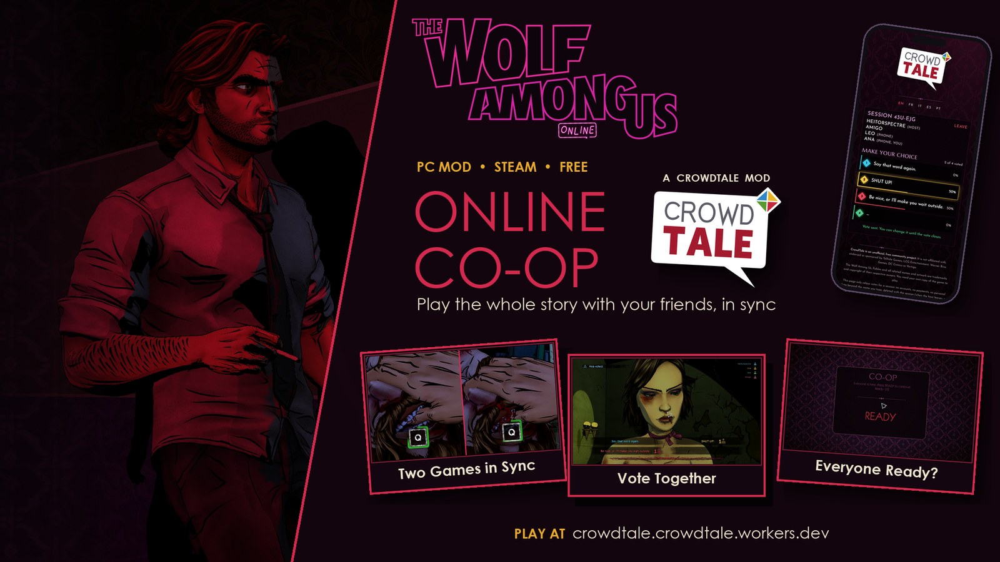
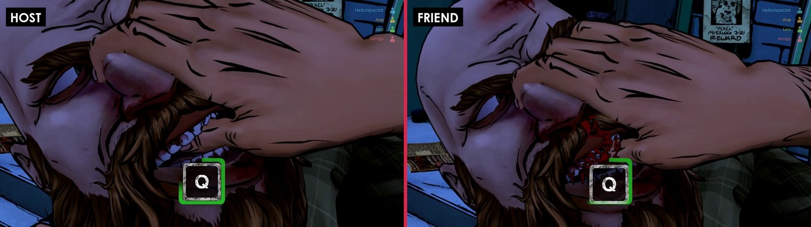
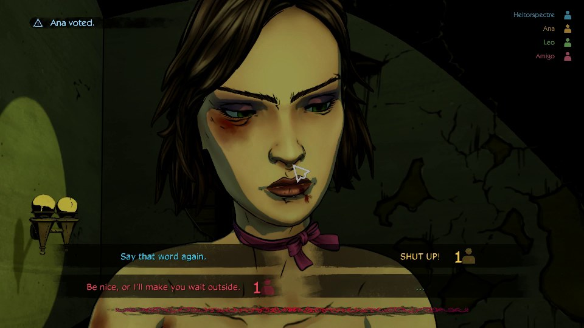
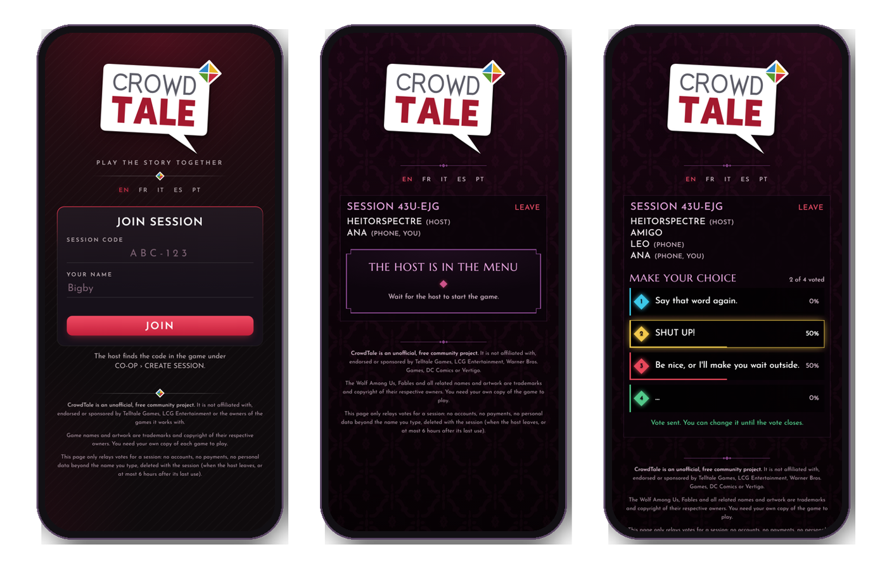
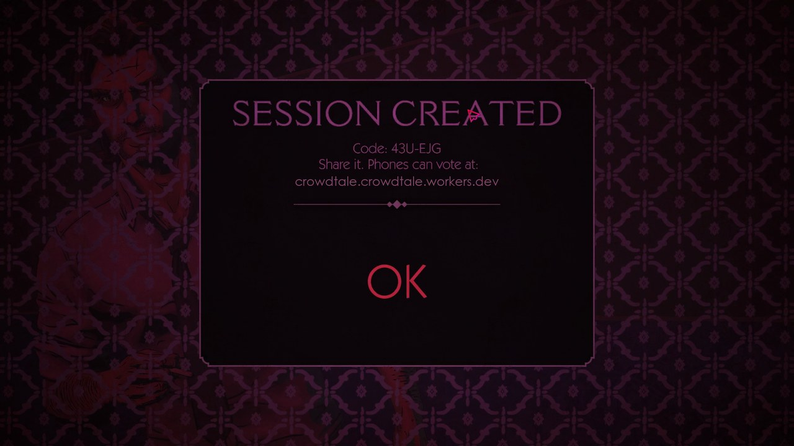
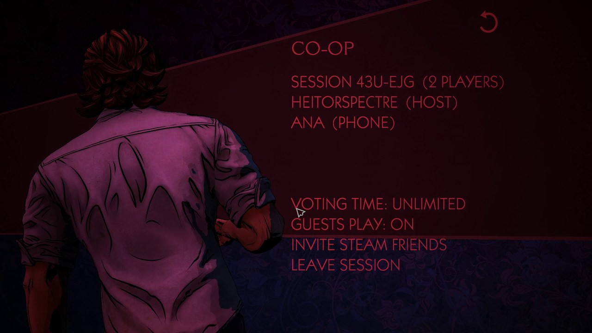
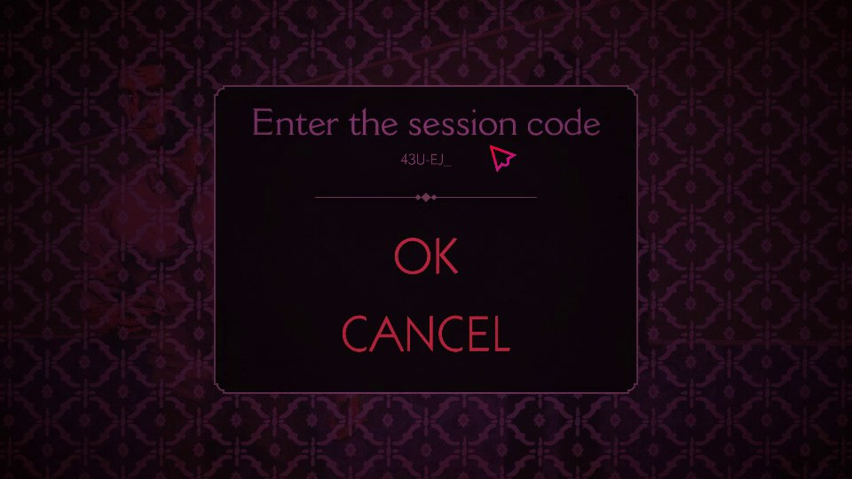
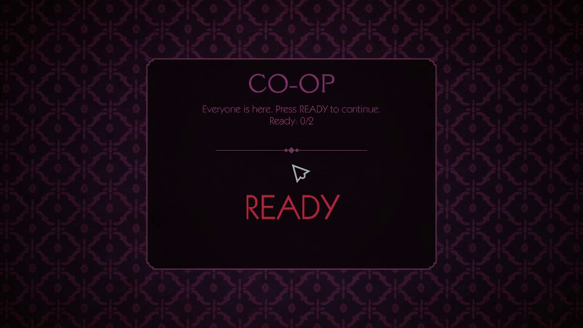
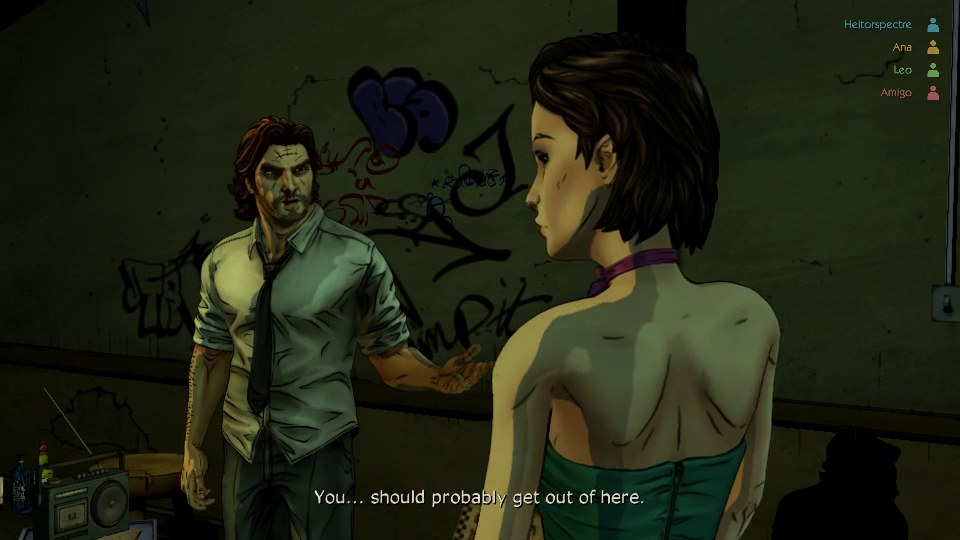
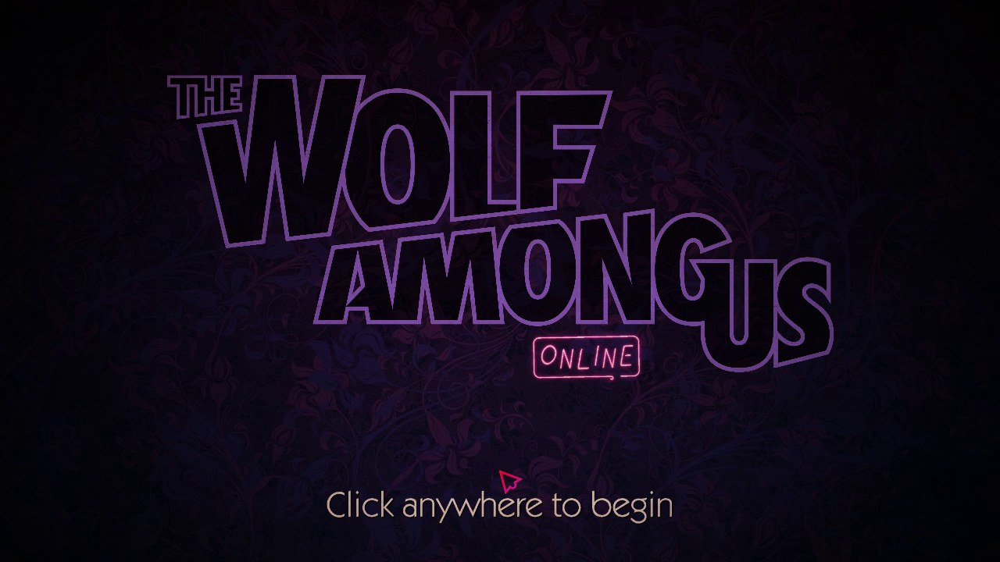

<h1 align="center">CrowdTale</h1>

  

<b>Play the story together.</b> 
Online co-op for Telltale games: play the same episode with a friend, and let everyone decide what happens next.

  <a href="https://github.com/HeitorSpectre/CrowdTale/releases/latest"><b>Download</b></a> ·
  <a href="https://crowdtale.crowdtale.workers.dev"><b>Vote from your phone</b></a>

  

## Supported games

| Game | Platform | Status |
| --- | --- | --- |
| The Wolf Among Us (Remastered) | PC, Steam | Available |

More Telltale games are planned.

## Features

### Play the same story, in sync
Each player runs the game on their own PC. When the host moves to a new scene, the friend's game follows on its own. Both of you control your own Bigby, and the action sequences play out the same way on both screens.

### Everyone votes on the choices
Every dialogue choice becomes a group vote. The answer with the most votes wins, and in a tie the host decides. Votes show up live in the game, with a color for each answer.

### Friends without the game can vote from a phone
No install, no account. Open the site, type the session code and a name, and vote from any phone or browser. The page takes on the look of the game you're playing.

### Create a session in seconds
The ONLINE menu is built into the game's main menu. Create a session, share the code or invite your Steam friends, and watch everyone appear in the lobby as they join.

<table>
  <tr>
    <td></td>
    <td></td>
  </tr>
  <tr>
    <td align="center">Your session code, ready to share</td>
    <td align="center">The lobby, with the host's settings</td>
  </tr>
</table>

### Start together
Your friend joins from their own game with the same code. Before each scene starts, everyone presses READY, so nobody misses the beginning.

<table>
  <tr>
    <td></td>
    <td></td>
  </tr>
  <tr>
    <td align="center">Join from your game</td>
    <td align="center">Everyone ready? Let's go</td>
  </tr>
</table>

### See who's playing
During an episode, everyone in the session is listed in the corner of the screen, each in their own color, including the people voting from a phone.

<table>
  <tr>
    <td></td>
    <td></td>
  </tr>
  <tr>
    <td align="center">Players in the corner of the screen</td>
    <td align="center">A title screen made for online play</td>
  </tr>
</table>

### Host settings
- **Voting time:** the game's own timer, extra seconds, or unlimited (the vote waits for everyone).
- **Guests play:** let your friend walk and explore freely, or just follow along.
- **Remove players** from the lobby.

## How to play

1. Download the latest release and extract it into the game folder (Steam > right-click the game > Manage > Browse local files).
2. **Host:** main menu > **ONLINE** > **CREATE SESSION**, then invite your Steam friends or send them the code.
3. **Friend with the game:** **ONLINE** > **JOIN SESSION** and type the code.
4. **Friends on a phone:** open <https://crowdtale.crowdtale.workers.dev> and type the code.
5. **Host:** start an episode. Press READY when the box shows up, and enjoy the story together.

Both players need the game on Steam, with the Steam overlay turned on. The mod doesn't change any of the game's own files. To remove it, delete the files it added.

## What's in this repository

| Folder | What it is |
| --- | --- |
| [`site`](site) | The online service that hosts the sessions and the voting page. |
| [`dll`](dll) | The small component the game loads to talk to Steam and to the other players. |
| [`mod`](mod) | The in-game part, laid out like the game's `Archives` folder: menus, texts, textures and scripts. |

## Disclaimer

CrowdTale is a free, unofficial fan-made project. It is not affiliated with, endorsed or sponsored by Telltale Games, LCG Entertainment, Warner Bros. Games, DC Comics or Vertigo. The Wolf Among Us, Fables and all related names and artwork are trademarks and copyright of their respective owners. You need your own copy of the game to play.
